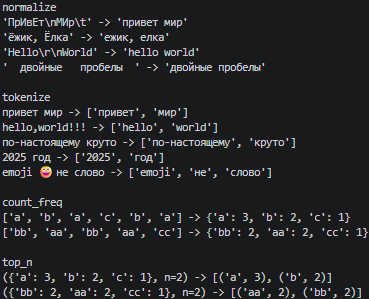
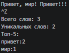

## Лабораторная работа №3: Тексты и частоты слов (словарь/множество)

### Задание 1 — text.py
* **Файл:** `src/lib/text.py`
* **Ход работы:** `Программа реализует три функции для работы со списками. Функция min_max находит минимальное и максимальное значение в списке без использования встроенных функций min() и max(). Функция unique_sorted формирует отсортированный по возрастанию список уникальных элементов без использования функций sort() и sorted(). Функция flatten принимает список списков или кортежей и «распрямляет» его в один плоский одномерный список, проверяя типы данных.`
* **Результат работы:**

### Задание 2 — text_stats.py
* **Файл:** `src/text_stats.py`
* **Ход работы:** `Программа содержит функции для обработки двумерных списков (прямоугольных матриц). Функция transpose меняет строки и столбцы матрицы местами, предварительно проверяя её на «рваные» края. Функции row_sums и col_sums последовательно вычисляют суммы элементов по каждой строке и по каждому столбцу соответственно, генерируя исключение при нарушении прямоугольной формы таблицы.`
* **Результат работы:**

