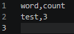
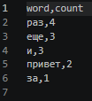

## Лабораторная работа №4: Файлы: TXT/CSV и отчёты по текстовой статистике

### Задание 1 — io_txt_csv.py
* **Файл:** `src/lab04/io_txt_csv.py`
* **Ход работы:** `Разработана библиотека src/lib/text.py для обработки текстовых данных. Реализованы механизмы очистки строк от лишних пробелов и спецсимволов с помощью регулярных выражений, приведения регистра и замены букв «Ё» на «Е». Написан алгоритм токенизации текста на отдельные слова с сохранением дефисов и игнорированием знаков препинания. Создана функция подсчета частоты слов на базе словаря и реализован ручной алгоритм сортировки пузырьком для поиска топ-N популярных слов с учетом алфавитного порядка при равенстве частот. Во все функции добавлена строгая ручная валидация типов данных с генерацией исключений TypeError и ValueError.`
* **Результат работы:**

### Задание 2 — text_report.py
* **Файл:** `src/lab04/text_report.py`
* **Ход работы:** `Создан исполняемый скрипт src/text_stats.py, использующий функции разработанной библиотеки. В скрипте настроена автоматическая конфигурация путей sys.path для корректного импорта модулей из любой рабочей директории. Реализован потоковый прием текстовых данных из стандартного ввода sys.stdin.read() до достижения маркера конца файла EOF, что обеспечивает поддержку работы программы как через консольный конвейер, так и через ручной ввод. Скрипт последовательно обрабатывает входящий текст и выводит в консоль итоговый отчет, содержащий общее количество слов, число уникальных токенов и список топ-5 популярных слов в формате слово:кол-во.`
* **Результат работы:**

