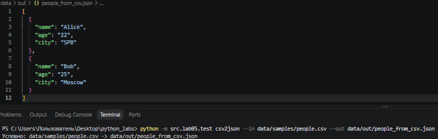
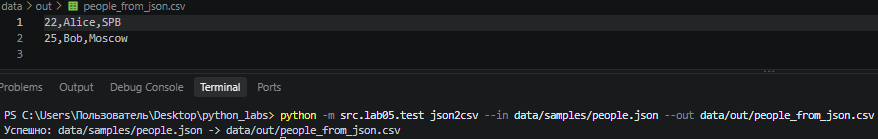
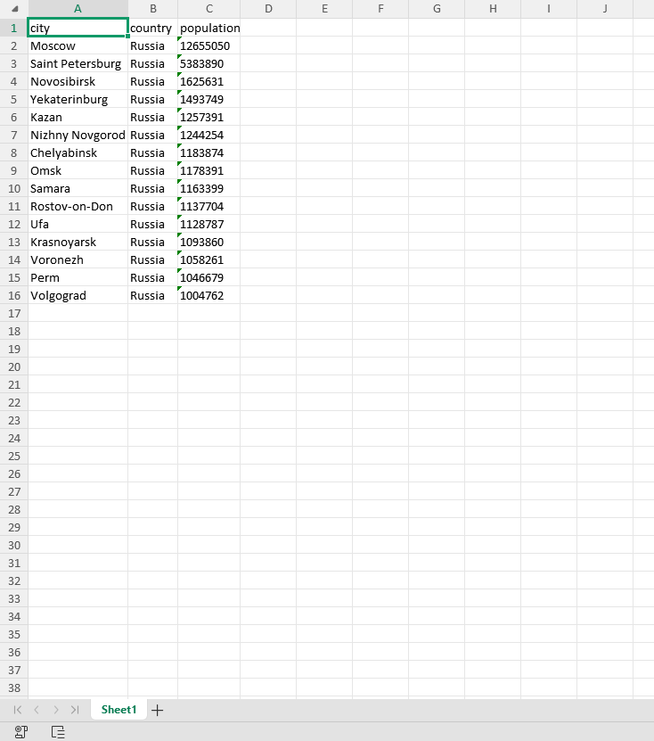

## Лабораторная работа №5: JSON и конвертации (JSON↔CSV, CSV→XLSX): Техническое задание

### Задание 1 — json_csv.py
* **Файл:** `src/lab05/json_csv.py`
* **Ход работы:** `Скрипт читает JSON-файл (список словарей), собирает все уникальные ключи как заголовки таблицы и записывает данные в CSV. Если в каком-то словаре отсутствует ключ, в ячейку записывается пустая строка. Аналогично наоборот.`
* **Результат работы:**

### Задание 2 — csv_xlsx.py
* **Файл:** `src/lab05/csv_xlsx.py`
* **Ход работы:** `Скрипт использует библиотеку openpyxl. Он создает новый Excel-файл, переносит туда данные из CSV, называет первый лист "Sheet1" и автоматически подбирает ширину колонок (минимум 8 символов) на основе длины самого длинного текста в колонке.`
* **Результат работы:**

