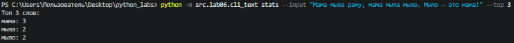
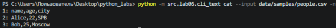

## Лабораторная работа №6: CLI‑утилиты с argparse (cat/grep‑lite + конвертеры): Техническое задание

### Задание 1 — cli_convert.py
* **Файл:** `src/lab06/cli_convert.py`
* **Ход работы:** `Модуль использует argparse с подкомандами (subparsers), чтобы для каждого формата данных была своя команда со своими аргументами. Примеры работы есть в описании lab05`

### Задание 2 — cli_text.py
* **Файл:** `src/lab06/cli_text.py`
* **Ход работы:** `Подкоманда stats принимает текст через обязательный --input (строкой в кавычках) и опциональный --top (по умолчанию 5). Текст передаётся в count_words(), которая очищает его от пунктуации, приводит к нижнему регистру и считает частоты в словаре. Словарь идёт в top_n() из ЛР3, возвращающую топ-N слов. Подкоманда cat принимает путь к файлу через --input и флаг -n для нумерации. Функция cat_file() проверяет наличие файла и выводит строки через enumerate(f, start=1). Ошибки (FileNotFoundError) перехватываются в try/except, выводятся в stderr, программа завершается с кодом 1.`
* **Результат работы:**

