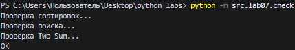
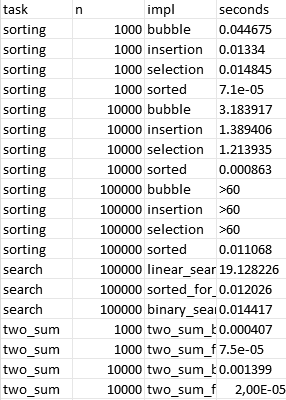

## Лабораторная работа №7: Поиск, сортировка и измерение времени

### Задание 1 — check.py
* **Файл:** `src/lab07/check.py`
* **Ход работы:** `Модуль проверки алгоритмов поиска и сортировки. Содержит функции для сравнения реализованных алгоритмов с эталонными встроенными методами Python (sorted, list.index()) на случайных данных.Использует assert для мгновенного прерывания при расхождении.`
* **Результат работы:**

### Задание 2 — bench.py
* **Файл:** `src/lab07/bench.py`
* **Ход работы:** `Модуль бенчмарка (замера времени) алгоритмов. Замеряет время выполнения реализованных сортировок и поиска на разных объемах данных (от 1 000 до 100 000 элементов) и сравнивает их со встроенными функциями Python. Результаты сохраняются в CSV.`
* **Результат работы:**

